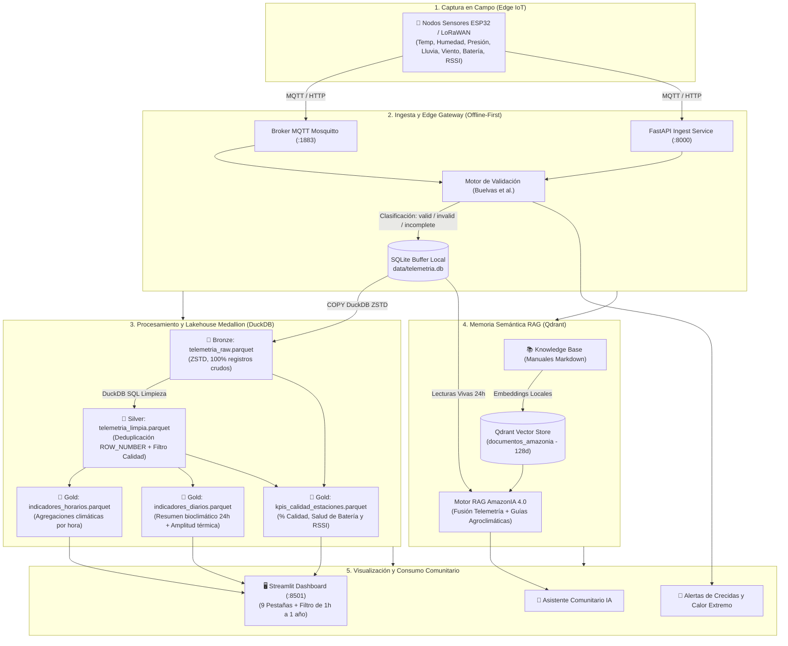

# 🌿 AmazonIA 4.0 — Arquitectura de Datos Inteligente en el Borde
## Telemetría Microclimática, Lakehouse Medallion y Memoria Semántica en la Cuenca del Río Caroní

[](https://www.python.org/)
[](https://fastapi.tiangolo.com/)
[](https://streamlit.io/)
[](https://duckdb.org/)
[](https://parquet.apache.org/)
[](https://qdrant.tech/)
[](https://airflow.apache.org/)
[](https://www.sqlite.org/)
[](https://pytest.org/)
[](LICENSE)

---

## 📋 Tabla de Contenidos

- [1. Descripción General](#1-descripción-general)
- [2. Problemática en la Cuenca del Río Caroní](#2-problemática-en-la-cuenca-del-río-caroní)
- [3. Arquitectura del Sistema](#3-arquitectura-del-sistema)
- [4. Tecnologías y Componentes de Datos Inteligentes](#4-tecnologías-y-componentes-de-datos-inteligentes)
  - [4.1. Memoria Semántica y Asistente Agroclimático RAG (Qdrant)](#41-memoria-semántica-y-asistente-agroclimático-rag-qdrant)
  - [4.2. Pipeline Medallion Lakehouse (DuckDB + Parquet ZSTD)](#42-pipeline-medallion-lakehouse-duckdb--parquet-zstd)
  - [4.3. Orquestador de Pipelines (Apache Airflow y Runner Local)](#43-orquestador-de-pipelines-apache-airflow-y-runner-local)
- [5. Estructura del Repositorio](#5-estructura-del-repositorio)
- [6. Guía de Ejecución: Modo Local (Offline-First sin Docker)](#6-guía-de-ejecución-modo-local-offline-first-sin-docker)
  - [6.1. Instalación de Dependencias](#61-instalación-de-dependencias)
  - [6.2. Despliegue Unificado con un Solo Comando (`start.py`)](#62-despliegue-unificado-con-un-solo-comando-startpy)
  - [6.3. Ejecución del Pipeline Analítico Completo Medallion & RAG](#63-ejecución-del-pipeline-analítico-completo-medallion--rag)
  - [6.4. Ejecución del Conjunto de Pruebas Automatizadas (55 Tests)](#64-ejecución-del-conjunto-de-pruebas-automatizadas-55-tests)
- [7. Guía de Ejecución: Modo Contenedores (Docker & Airflow Stack)](#7-guía-de-ejecución-modo-contenedores-docker--airflow-stack)
  - [7.1. Requisitos de Docker](#71-requisitos-de-docker)
  - [7.2. Inicialización de Airflow (`airflow_init.bat`)](#72-inicialización-de-airflow-airflow_initbat)
  - [7.3. Despliegue del Stack Completo](#73-despliegue-del-stack-completo)
  - [7.4. Accesos a Interfaces y Credenciales](#74-accesos-a-interfaces-y-credenciales)
  - [7.5. Detención y Mantenimiento de Contenedores](#75-detención-y-mantenimiento-de-contenedores)
- [8. Marco de Calidad de Datos (Buelvas et al., 2023)](#8-marco-de-calidad-de-datos-buelvas-et-al-2023)
- [9. Referencia de Endpoints API REST](#9-referencia-de-endpoints-api-rest)
- [10. Documentos Técnicos y Académicos Complementarios](#10-documentos-técnicos-y-académicos-complementarios)
- [11. Autores y Créditos Académicos](#11-autores-y-créditos-académicos)

---

## 1. Descripción General

**AmazonIA 4.0** es una plataforma integral de ingeniería de datos inteligente diseñada para operar en el borde (*Edge Computing*) en la cuenca del Río Caroní (Estado Bolívar, Venezuela). Su propósito es procesar, depurar y correlacionar variables microclimáticas provenientes de estaciones meteorológicas comunitarias autónomas, integrando:

- **Enfoque Offline-First Total:** El sistema garantiza continuidad operativa y diagnóstica en comunidades agrícolas e indígenas sin conexión a Internet o en presencia de fallas eléctricas prolongadas.
- **Buffer Inmutable Transaccional (SQLite):** Registra cada trama cruda recibida preservando su integridad física y auditabilidad.
- **Lakehouse Medallion Embebido (DuckDB + Apache Parquet ZSTD):** Provee capacidades OLAP analíticas de alto rendimiento sin requerir infraestructuras pesadas de Big Data basadas en Java/Spark.
- **Memoria Semántica RAG (Qdrant + Embeddings Locales de 128 Dimensiones):** Correlaciona la telemetría viva de los sensores con manuales agronómicos locales para emitir recomendaciones agrícolas y alertas de crecidas del río.

---

## 2. Problemática en la Cuenca del Río Caroní

La cuenca del río Caroní y el sur de Venezuela presentan condiciones ambientales y de infraestructura sumamente adversas:
- **Ausencia de conectividad:** Cobertura celular nula en zonas de selva y sabana, con enlaces satelitales intermitentes o de muy bajo ancho de banda.
- **Inestabilidad del suministro eléctrico:** Racionamientos prolongados y dependencia exclusiva de energía solar fotovoltaica con baterías de litio.
- **Pérdida histórica de telemetría:** Los sistemas centralizados tradicionales pierden las lecturas cuando se cae el enlace de red hacia la nube.
- **Falta de interpretación contextual comunitaria:** Los datos crudos no ofrecen utilidad directa a los productores locales si no se traducen en recomendaciones prácticas de siembra (yuca, maíz, plátano) o alertas tempranas de crecidas fluviales.

---

## 3. Arquitectura del Sistema



---

## 4. Tecnologías y Componentes de Datos Inteligentes

### 4.1. Memoria Semántica y Asistente Agroclimático RAG (Qdrant)
- **Base Vectorial:** [Qdrant](https://qdrant.tech/) con colección `documentos_amazonia` y métrica de distancia de Coseno.
- **Funcionamiento Híbrido Automático:** Se conecta al servidor Qdrant en red (`http://localhost:6333`) si está disponible; en caso contrario, activa su **motor embebido local en disco** (`data/qdrant_storage/`), garantizando disponibilidad en computadores de campo sin Docker ni Internet.
- **Embeddings Deterministas Locales (128d):** Función de dispersión criptográfica por $n$-gramas con normalización Euclidiana $L_2$ ($\hat{\mathbf{v}} = \frac{\mathbf{v}}{\|\mathbf{v}\|_2}$), permitiendo calcular similitud semántica en CPU en milisegundos sin depender de OpenAI ni conexión a red.
- **Base de Conocimiento (`knowledge_base/`):** Manuales técnicos sobre requerimientos hídricos de cultivos de la cuenca (yuca amarga y dulce, maíz amarillo, plátano hartón), protocolos de protección civil ante crecidas del Caroní y mantenimiento fotovoltaico de estaciones.

### 4.2. Pipeline Medallion Lakehouse (DuckDB + Parquet ZSTD)
Implementa la arquitectura columnar Medallion mediante el motor OLAP embebido **DuckDB 2.0.0**:
- **Capa Bronze (`data/lakehouse/bronze/telemetria_raw.parquet`):**
  - Ingesta inmutable desde la tabla `telemetria` de SQLite.
  - Almacena el 100% de los datos crudos con el sello temporal `ingesta_lakehouse_ts` para auditoría.
- **Capa Silver (`data/lakehouse/silver/telemetria_limpia.parquet`):**
  - Deduplicación analítica mediante ventana SQL:
    $$\text{ROW\_NUMBER}() \text{ OVER (PARTITION BY estacion\_id, timestamp ORDER BY id DESC)} = 1$$
  - Filtro estricto de calidad: `WHERE estado_calidad = 'valid'`.
  - Normalización de anomalías térmicas ($<-10^\circ\text{C}$ o $>60^\circ\text{C} \to \text{NULL}$).
- **Capa Gold (Datamarts Analíticos Especializados):**
  - `indicadores_horarios.parquet`: Agregaciones horarias (temperatura media/mín/máx, humedad media, lluvia acumulada, ráfagas de viento, voltaje promedio y total de lecturas).
  - `indicadores_diarios.parquet`: Resumen bioclimático de 24 horas con amplitud térmica ($\Delta T = T_{\max} - T_{\min}$) y precipitación total diaria.
  - `kpis_calidad_estaciones.parquet`: Evaluación de salud técnica (% de datos válidos vs recibidos, promedio de batería y señal RSSI).

#### Consultas Analíticas Directas con DuckDB SQL:
```python
from src.lakehouse.manager import AmazonIALakehouse

lh = AmazonIALakehouse()
# Consultar indicadores Gold directamente sobre Parquet
df_clima = lh.consultar_sql("""
    SELECT estacion_id, date_trunc('day', hora) AS dia, 
           AVG(temp_promedio) AS temp_media, SUM(precipitacion_acumulada) AS lluvia_total
    FROM read_parquet('data/lakehouse/gold/indicadores_horarios.parquet')
    GROUP BY estacion_id, date_trunc('day', hora)
    ORDER BY dia DESC
""")
print(df_clima.head())
```

### 4.3. Orquestador de Pipelines (Apache Airflow y Runner Local)
- **Apache Airflow (`dags/pipeline_amazonia.py`):** DAG orquestador calibrado con `EmptyOperator`, sondeo de Gateway, reintentos con backoff y pasaje de métricas por XCom.
- **Runner Autónomo Local (`run_pipeline_local.py`):** Ejecuta en un solo proceso de Python las 5 etapas sin requerir Docker ni servicios externos:
  1. Sincronización del buffer Edge.
  2. Ingesta Bronze y Depuración Silver con DuckDB.
  3. Agregaciones Gold (horarios, diarios, KPIs) con DuckDB.
  4. Indexación de manuales en la memoria semántica Qdrant.
  5. Evaluación de umbrales críticos comunitarios (crecidas, calor y batería).

---

## 5. Estructura del Repositorio

```
amazonia4.0-mvp/
├── README.md                          # Documentación central del proyecto
├── informeTecnico.md                  # Informe técnico detallado de arquitectura e IA
├── disenodearq.md                     # Documento formal C4 y especificación de capas
├── requirements.txt                   # Dependencias de Python (.venv)
├── proyect.toml                       # Configuración de herramientas (pytest, ruff)
├── docker-compose.yml                 # Definición completa del stack contenerizado
├── dockerfile                         # Imagen base de los microservicios
├── start.py / start.bat               # Orquestador unificado de inicio rápido local
├── run_pipeline_local.py              # Runner local del Pipeline Medallion & RAG
├── airflow_init.bat                   # Inicializador automático de Airflow y usuario admin
│
├── dags/                              # DAGs y scripts para Apache Airflow
│   ├── pipeline_amazonia.py           # DAG principal del pipeline AmazonIA 4.0
│   ├── scripts/
│   │   ├── bronze_to_silver.py        # Ingesta Bronze y Depuración Silver (DuckDB)
│   │   ├── silver_to_gold.py          # Generación de Datamarts Gold (DuckDB)
│   │   └── rag_indexer.py             # Indexador de la base vectorial Qdrant
│   └── utils/
│       └── helpers.py                 # Utilidades de directorios y rutas
│
├── knowledge_base/                    # Base de conocimiento agronómico e hidrológico
│   ├── agroclima_caroni.md            # Requerimientos de yuca, maíz y plátano
│   ├── alertas_inundacion.md          # Protocolos de crecidas y Protección Civil
│   └── mantenimiento_estaciones.md    # Salud de paneles, baterías y sensores
│
├── data/                              # Almacenamiento persistente local (Offline-First)
│   ├── telemetria.db                  # Base de datos SQLite (Buffer transaccional)
│   ├── qdrant_storage/                # Almacenamiento vectorial en disco de Qdrant
│   └── lakehouse/                     # Almacenamiento columnar Parquet
│       ├── bronze/telemetria_raw.parquet
│       ├── silver/telemetria_limpia.parquet
│       └── gold/
│           ├── indicadores_horarios.parquet
│           ├── indicadores_diarios.parquet
│           └── kpis_calidad_estaciones.parquet
│
├── src/                               # Módulos del núcleo del sistema
│   ├── config.py                      # Umbrales críticos y rutas de entorno
│   ├── database.py                    # Persistencia transaccional SQLite (WAL)
│   ├── validacion.py                  # Motor de calidad (Buelvas et al.)
│   ├── api.py                         # API REST de ingesta y consultas (FastAPI)
│   ├── dashboard.py                   # Dashboard con 9 pestañas y Chat RAG (Streamlit)
│   ├── simulador.py                   # Generador de telemetría de campo
│   ├── sincronizacion.py              # Agente de sincronización con backoff
│   ├── mqtt_publicador.py             # Publicador de sensores hacia Mosquitto
│   ├── mqtt_suscriptor.py             # Suscriptor y Bridge MQTT hacia SQLite
│   ├── lakehouse/                     # Motor OLAP Medallion DuckDB
│   │   ├── __init__.py
│   │   └── manager.py                 # Clase AmazonIALakehouse
│   └── rag/                           # Memoria semántica y RAG
│       ├── __init__.py
│       ├── vector_store.py            # Cliente y almacenamiento Qdrant
│       └── engine.py                  # Motor de diagnóstico y razonamiento agroclimático
│
└── tests/                             # Suite de 55 pruebas automatizadas (pytest)
    ├── test_api.py                    # 7 pruebas para endpoints FastAPI
    ├── test_database.py               # 7 pruebas para persistencia SQLite
    ├── test_validacion.py             # 11 pruebas de calidad de datos
    ├── test_mqtt.py                   # 7 pruebas para mensajería Mosquitto
    ├── test_rag.py                    # 6 pruebas para vector store y embeddings
    ├── test_pipeline.py               # 7 pruebas para transformaciones del pipeline
    └── test_lakehouse.py              # 10 pruebas directas para DuckDB Lakehouse
```

---

## 6. Guía de Ejecución: Modo Local (Offline-First sin Docker)

El modo local está diseñado para desarrolladores, investigadores y operadores en campo. **No requiere Docker, PostgreSQL ni conexión a Internet.**

### 6.1. Instalación de Dependencias

```bash
# 1. Clonar el repositorio
git clone https://github.com/rodriguezjr/amazonIA.git
cd amazonia4.0-mvp

# 2. Crear y activar entorno virtual
python -m venv .venv

# En Windows:
.venv\Scripts\activate
# En Linux/macOS:
source .venv/bin/activate

# 3. Instalar librerías
pip install --upgrade pip
pip install -r requirements.txt

# 4. Crear archivo de variables de entorno
cp .env.example .env
```

### 6.2. Despliegue Unificado con un Solo Comando (`start.py`)

Para no abrir múltiples ventanas de terminal, el proyecto cuenta con un orquestador unificado de procesos:

```bash
# Ejecutar todo el sistema (API + Dashboard + Simulador de sensores):
python start.py
```
> **En Windows:** Puedes simplemente hacer doble clic en el archivo **`start.bat`**.

Este comando automáticamente:
1. Verifica e inicializa la base de datos SQLite si es necesario.
2. Inicia la **API FastAPI** en segundo plano (`http://localhost:8000`).
3. Inicia el **Dashboard Streamlit** (`http://localhost:8501`).
4. Inicia el **Simulador de telemetría** que genera lecturas continuas.
5. Abre el navegador web automáticamente en el Dashboard.
6. Al presionar `Ctrl + C`, apaga de forma segura todos los subprocesos.

#### Modos de Ejecución Opcionales:
```bash
python start.py --sin-simulador    # Inicia solo API y Dashboard (sin datos simulados)
python start.py --modo mqtt        # Inicia con Bridge MQTT y Publicador Mosquitto
```

### 6.3. Ejecución del Pipeline Analítico Completo Medallion & RAG

Para procesar los datos de SQLite, actualizar las capas Parquet (Bronze $\to$ Silver $\to$ Gold) e indexar el conocimiento RAG en Qdrant:

```bash
python run_pipeline_local.py
```

**Salida generada:**
```text
=================================================================
   AMAZONIA 4.0 - PIPELINE MEDALLION DUCKDB & IA (OFFLINE-FIRST)
=================================================================
[1/5] Sincronizacion Edge Buffer...
      [OK] Sincronizacion completada
[2/5] Capa Bronze -> Silver (Ingesta & Limpieza DuckDB SQL)...
      [OK] Total Bronze leidos: 864 registros (21.27 KB)
      [OK] Registros validos en Silver: 591 registros (16.81 KB)
[3/5] Capa Gold (Datamarts Analiticos DuckDB)...
      [OK] Agregaciones horarias calculadas: 23
      [OK] Resumenes diarios generados: 15
      [OK] KPIs de estaciones evaluados: 8
[4/5] Indexacion RAG (Memoria Semantica Qdrant)...
      [OK] Documentos tecnicos indexados: 10 chunks en 'documentos_amazonia'
[5/5] Evaluacion de Umbrales de Alerta...
      [OK] Evaluacion finalizada.
=================================================================
   [EXITO] PIPELINE COMPLETADO SATISFACTORIAMENTE
   Almacenamiento Lakehouse Parquet:
     - Capa BRONZE: 1 archivo(s), 21.27 KB
     - Capa SILVER: 1 archivo(s), 16.81 KB
     - Capa GOLD: 3 archivo(s), 6.47 KB
=================================================================
```

### 6.4. Ejecución del Conjunto de Pruebas Automatizadas (55 Tests)

```bash
pytest tests/ -v
```

Todos los módulos cuentan con cobertura de pruebas unitarias:
- `test_api.py` (7 tests): Endpoints de salud, ingesta, batch y alertas.
- `test_database.py` (7 tests): Inicialización de tablas, índices e inserción.
- `test_validacion.py` (11 tests): Rangos físicos, completitud y clasificación de calidad.
- `test_mqtt.py` (7 tests): Serialización de tramas, conexión y tópicos.
- `test_rag.py` (6 tests): Embeddings 128d, almacenamiento en Qdrant y diagnóstico RAG.
- `test_pipeline.py` (7 tests): Integración Bronze $\to$ Silver $\to$ Gold y consistencia.
- `test_lakehouse.py` (10 tests): DuckDB SQL, deduplicación analítica y consultas ad-hoc.

---

## 7. Guía de Ejecución: Modo Contenedores (Docker & Airflow Stack)

El modo contenedores está diseñado para despliegue en servidores, clústeres o estaciones centrales donde se requiera orquestación programada con **Apache Airflow**.

### 7.1. Requisitos de Docker
- Docker Engine 24.x o superior.
- Docker Compose v2.x (`docker compose`).
- Al menos 4 GB de memoria RAM asignada al demonio de Docker.

### 7.2. Inicialización de Airflow (`airflow_init.bat`)

Antes de levantar el stack por primera vez, es necesario inicializar la base de datos de metadatos de Airflow y crear el usuario administrador:

```bash
# En Windows:
airflow_init.bat

# En Linux / macOS:
docker compose up -d postgres redis
docker compose run --rm airflow-init
```

El script creará automáticamente el usuario con credenciales:
- **Usuario:** `admin`
- **Contraseña:** `admin123`

### 7.3. Despliegue del Stack Completo

```bash
# Levantar todos los servicios en segundo plano:
docker compose up -d
```

#### Servicios Levantados en el Stack:
1. `amazonia-postgres`: Base de datos de metadatos de Airflow (:5432).
2. `amazonia-redis`: Broker de mensajes Celery para tareas de Airflow (:6379).
3. `amazonia-airflow-webserver`: Interfaz web de Apache Airflow (:8080).
4. `amazonia-airflow-scheduler`: Planificador y monitor de DAGs.
5. `amazonia-airflow-worker`: Ejecutor distribuido de tareas del pipeline.
6. `amazonia-qdrant`: Servidor vectorial semántico (:6333, :6334).
7. `amazonia-mosquitto`: Broker de mensajería IoT MQTT (:1883).
8. `amazonia-api`: API REST FastAPI (:8000).
9. `amazonia-dashboard`: Dashboard analítico Streamlit (:8501).

### 7.4. Accesos a Interfaces y Credenciales

| Servicio | URL Local | Credenciales / Notas |
|---|---|---|
| **Streamlit Dashboard** | [http://localhost:8501](http://localhost:8501) | Acceso directo sin autenticación |
| **Documentación API (Swagger)** | [http://localhost:8000/docs](http://localhost:8000/docs) | Endpoints interactivos OpenAPI |
| **Apache Airflow Webserver** | [http://localhost:8080](http://localhost:8080) | **User:** `admin` \| **Pass:** `admin123` |
| **Qdrant Vector Dashboard** | [http://localhost:6333/dashboard](http://localhost:6333/dashboard) | Consola visual de colecciones y puntos |
| **Broker MQTT Mosquitto** | `localhost:1883` | Tópicos: `amazonia/caroni/+/telemetria` |

### 7.5. Detención y Mantenimiento de Contenedores

```bash
# Ver estado y consumo de los contenedores:
docker compose ps

# Ver registros de logs en tiempo real:
docker compose logs -f airflow-scheduler

# Detener todos los servicios preservando volúmenes:
docker compose down

# Detener y reiniciar limpiando volúmenes (Precaución: borra datos de prueba):
docker compose down -v
```

---

## 8. Marco de Calidad de Datos (Buelvas et al., 2023)

Cada medición capturada pasa por el motor de validación en tiempo real antes de consolidarse en la base de datos:

| Variable | Unidad | Rango Físico Válido | Umbral de Alerta Comunitaria |
|---|---|---|---|
| **Temperatura** | °C | $-10.0 \le T \le 45.0$ | $> 38.0\,^\circ\text{C}$ (Calor extremo) |
| **Humedad Relativa** | % | $0.0 \le H \le 100.0$ | $< 25.0\,\%$ (Riesgo de incendios) |
| **Presión Atmosférica** | hPa | $800.0 \le P \le 1100.0$ | Variación brusca $> 5\,\text{hPa/h}$ |
| **Precipitación** | mm | $0.0 \le R \le 300.0$ | $> 50.0\,\text{mm/24h}$ (Crecida del Caroní) |
| **Velocidad del Viento** | km/h | $0.0 \le V \le 150.0$ | $> 40.0\,\text{km/h}$ (Ráfagas peligrosas) |
| **Voltaje de Batería** | V | $2.5 \le B \le 5.0$ | $< 3.40\,\text{V}$ (Batería baja fotovoltaica) |
| **Señal de Radio (RSSI)** | dBm | $-120 \le \text{RSSI} \le 0$ | $< -105\,\text{dBm}$ (Pérdida de enlace) |

- **`valid`:** Todos los parámetros se encuentran presentes y dentro de límites físicos normales.
- **`invalid`:** Alguno de los parámetros viola los rangos físicos (e.g., $150^\circ\text{C}$).
- **`incomplete`:** Falta un valor no crítico pero la trama preserva identificación y tiempo.

---

## 9. Referencia de Endpoints API REST

La API REST expone endpoints documentados bajo la especificación OpenAPI en `http://localhost:8000/docs`:

- `GET /health`: Comprobación de estado operativo del Edge Gateway.
- `POST /ingesta/telemetria`: Ingesta unitaria de una lectura de sensor con validación inmediata.
- `POST /ingesta/batch`: Ingesta masiva por lotes de tramas almacenadas en ráfagas.
- `GET /consultas/ultimas`: Recupera las últimas lecturas registradas (soporta filtro por estación).
- `GET /consultas/filtradas`: Consulta por rango temporal y estación.
- `GET /alertas`: Lista las condiciones anómalas activas detectadas en la cuenca.
- `GET /calidad/resumen`: Estadísticas globales de registros válidos, inválidos e incompletos.

---

## 10. Documentos Técnicos y Académicos Complementarios

En la raíz del repositorio se encuentran disponibles los informes exhaustivos de ingeniería y arquitectura:
- **[`informeTecnico.md`](informeTecnico.md):** Documento técnico detallado con formulación matemática de los embeddings, código fuente comentado del reranker y la interfaz visual, y plan de despliegue en Kubernetes (StatefulSets, PVCs, HPAs).
- **[`disenodearq.md`](disenodearq.md):** Documento formal de arquitectura de datos bajo el **Modelo C4** (Contexto, Contenedores, Componentes), especificación pormenorizada de capas y estrategia de ingeniería adaptada a las restricciones extremas del sur de Venezuela.

---

## 11. Autores y Créditos Académicos

Proyecto desarrollado en el marco de la asignatura **Tipos de Datos Inteligentes** del programa de **Maestría en Tecnologías de la Información**:

- **Massiel Barrios** — C.I. 27.375.910
- **Luis Pizzanni** — C.I. 27.765.210
- **Junior Rodríguez** — C.I. 23.730.853

**Docente Asesora:** Profa. Livia Borjas  
**Institución:** Universidad Nacional Experimental de Guayana (UNEG)  
**Sede:** Puerto Ordaz, Estado Bolívar, Venezuela  
**Año:** 2026
