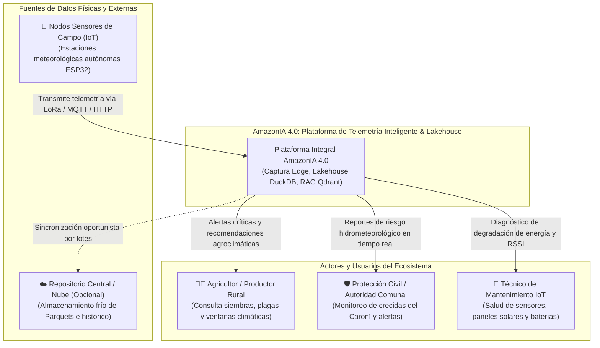
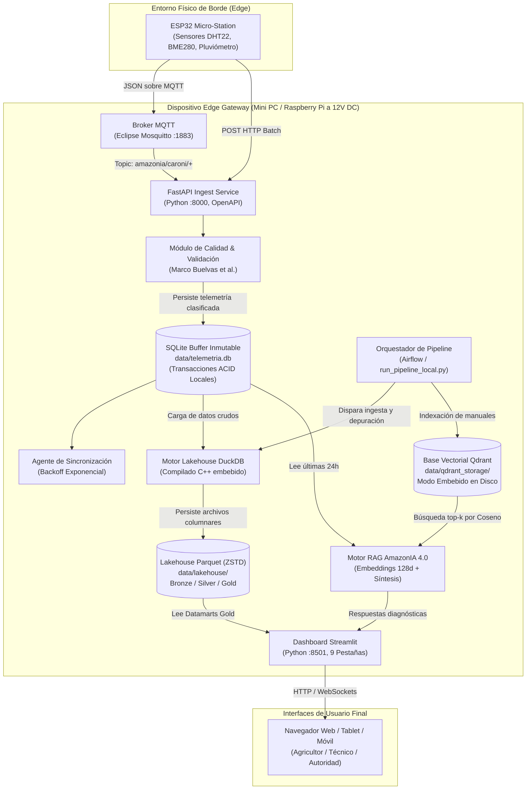
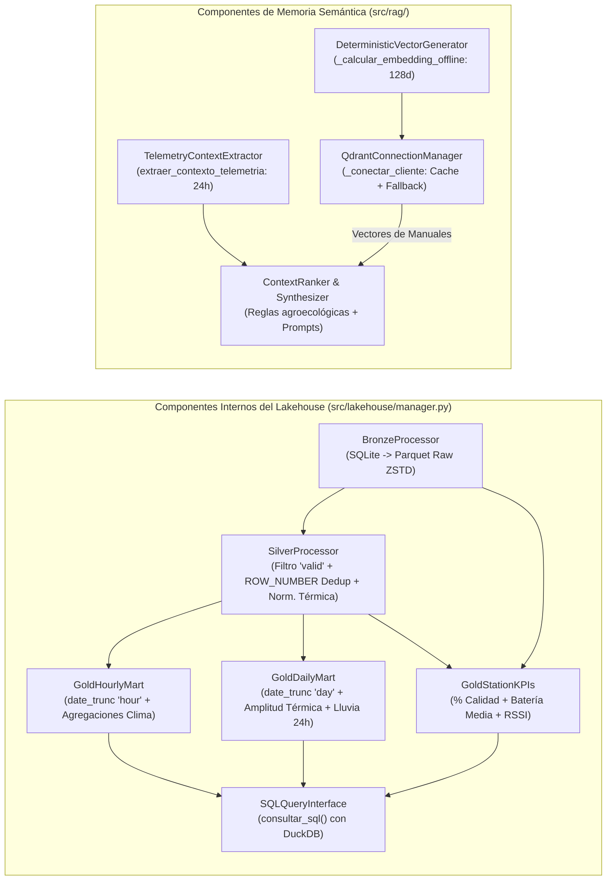
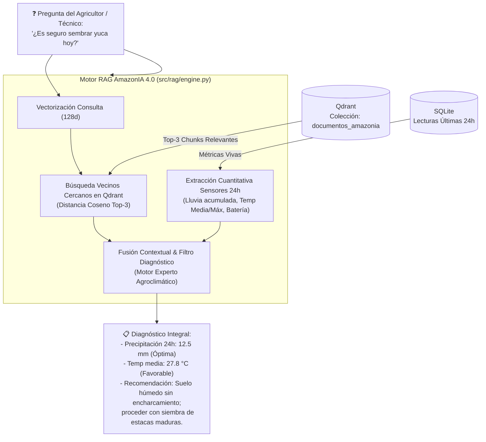
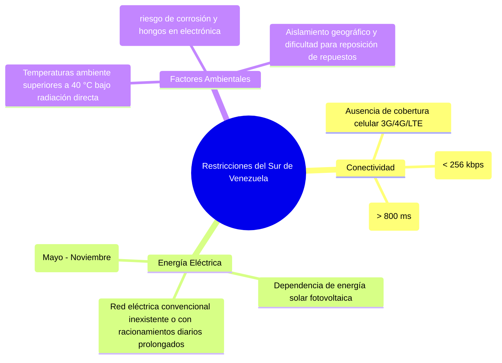

# DOCUMENTO DE DISEÑO DE ARQUITECTURA DE DATOS (ADD)
## Proyecto: AmazonIA 4.0 — Telemetría Inteligente, Lakehouse Medallion y Memoria Semántica
### Maestría en Tecnologías de la Información — Tipos de Datos Inteligentes
**Institución:** Universidad Nacional Experimental de Guayana (UNEG)  
**Docente:** Profa. Livia Borjas  
**Equipo de Investigación:**
- Massiel Barrios (C.I. 27.375.910)
- Luis Pizzanni (C.I. 27.765.210)
- Junior Rodríguez (C.I. 23.730.853)

---

## 1. Diagrama Formal de Componentes e Interacciones de Datos (Modelo C4)

Para representar de manera rigurosa y estandarizada la arquitectura de AmazonIA 4.0, se emplea el **Modelo C4** (*Context, Containers, Components, Code*), el cual permite comunicar la topología en diferentes niveles de abstracción para ingenieros de datos, operadores de campo e investigadores académicos.

---

### 1.1. Nivel 1: Diagrama de Contexto del Sistema (System Context)

El diagrama de contexto ilustra cómo AmazonIA 4.0 interactúa con los usuarios del ecosistema fluvial y agrícola de la cuenca del Río Caroní y con los sistemas de captura física en campo.



---

### 1.2. Nivel 2: Diagrama de Contenedores (Container Diagram)

El diagrama de contenedores desglosa la solución en sus límites computacionales ejecutables, almacenamiento y protocolos de comunicación.



---

### 1.3. Nivel 3: Diagrama de Componentes (Component Diagram: Módulo Lakehouse y RAG)

Este nivel describe internamente los componentes de software dentro del motor de procesamiento analítico y la memoria semántica:



---

## 2. Especificación Detallada por Capa

---

### 2.1. Capa de Ingesta (Edge Ingestion Layer)

La capa de ingesta es la puerta de entrada de todas las magnitudes físicas recolectadas en el terreno.

#### A. Protocolos y Canales de Comunicación
1. **MQTT (Message Queuing Telemetry Transport v3.1.1/v5.0):**
   - Utilizado por las microestaciones basadas en microcontroladores ESP32 con enlaces LoRaWAN hacia el Gateway o WiFi local.
   - **Tópico canónico:** `amazonia/caroni/{estacion_id}/telemetria`
   - **Calidad de Servicio (QoS):** `QoS 1` (At least once), garantizando que el mensaje llegue al broker incluso con fluctuaciones de señal.
2. **REST API (HTTP/1.1 JSON):**
   - Implementado en FastAPI (`src/api.py`).
   - Endpoint de telemetría unitaria: `POST /ingesta/telemetria`
   - Endpoint de telemetría por lotes: `POST /ingesta/batch` (procesamiento de ráfagas diferidas).

#### B. Marco de Validación de Calidad de Datos (Buelvas et al., 2023)
Cada paquete recibido se evalúa sintáctica y termodinámicamente en `src/validacion.py` antes de autorizar su consolidación:
- **Completitud:** Verifica la presencia de los campos obligatorios: `estacion_id`, `timestamp`, `temperatura`, `humedad`, `presion`, `precipitacion`, `viento`, `voltaje_bateria`, `rssi`. Si faltan campos clave pero existen mediciones parciales, se etiqueta como `incomplete`.
- **Validez de Rango Físico:**
  - Temperatura: $[-10.0, 45.0]\,^\circ\text{C}$
  - Humedad relativa: $[0.0, 100.0]\,\%$
  - Presión atmosférica: $[800.0, 1100.0]\,\text{hPa}$
  - Precipitación: $[0.0, 300.0]\,\text{mm}$
  - Velocidad del viento: $[0.0, 150.0]\,\text{km/h}$
  - Voltaje de batería: $[2.5, 5.0]\,\text{V}$
  - RSSI: $[-120, 0]\,\text{dBm}$
- **Clasificación Resultante:**
  - `valid`: Supera todas las pruebas.
  - `invalid`: Violación crítica de límites termodinámicos.
  - `incomplete`: Datos incompletos que requieren imputación posterior.

#### C. Buffer Persistente Local (SQLite Inmutable)
El Gateway opera una base de datos SQLite transaccional (`data/telemetria.db`):
- Modo de bitácora **WAL (Write-Ahead Logging)** para permitir lecturas concurrentes sin bloquear escrituras de sensores.
- Registro inmutable de cada trama recibida, asignando la fecha de recepción del servidor (`fecha_recepcion`) y la bandera de sincronización remota (`sincronizado = 0`).

---

### 2.2. Capa de Almacenamiento (Lakehouse Medallion con DuckDB y Parquet)

En lugar de utilizar arquitecturas complejas de Big Data basadas en Java Virtual Machine (JVM) como Apache Spark o Trino, AmazonIA 4.0 implementa una arquitectura **Lakehouse Medallion embebida** basada en **DuckDB** y **Apache Parquet**.

```
data/lakehouse/
├── bronze/
│   └── telemetria_raw.parquet               # Datos crudos inmutables
├── silver/
│   └── telemetria_limpia.parquet            # Datos limpios, deduplicados y normalizados
└── gold/
    ├── indicadores_horarios.parquet         # Datamart climático por hora
    ├── indicadores_diarios.parquet          # Datamart bioclimático por día (24h)
    └── kpis_calidad_estaciones.parquet      # Datamart de salud, disponibilidad y batería
```

#### Especificación de Capas Medallion:

| Capa | Archivo Destino | Compresión | Descripción y Propósito | Esquema y Transformación |
|---|---|---|---|---|
| **Bronze** | `bronze/telemetria_raw.parquet` | **ZSTD** (Nivel 3) | Registro inmutable de auditoría. Conserva el 100% de los datos brutos recibidos desde SQLite. | Agrega el metadato temporal `ingesta_lakehouse_ts` para trazabilidad de linaje de datos. |
| **Silver** | `silver/telemetria_limpia.parquet` | **ZSTD** (Nivel 3) | Capa limpia y deduplicada para análisis confiable. | - Filtro: `WHERE estado_calidad = 'valid'`<br>- Deduplicación: `ROW_NUMBER() OVER (PARTITION BY estacion_id, timestamp ORDER BY id DESC) = 1`<br>- Normalización: Temperaturas $<-10^\circ\text{C}$ o $>60^\circ\text{C} \to \text{NULL}$ |
| **Gold** (Horarios) | `gold/indicadores_horarios.parquet` | **ZSTD** | Métricas climáticas agregadas por hora para trazado de gráficos y series temporales. | `date_trunc('hour', timestamp)`<br>- Promedio, Máximo, Mínimo de Temperatura<br>- Humedad Promedio<br>- Precipitación Acumulada (`SUM`)<br>- Viento Promedio y Ráfaga Máxima<br>- Batería Promedio y Conteo de Lecturas |
| **Gold** (Diarios) | `gold/indicadores_diarios.parquet` | **ZSTD** | Resumen bioclimático diario para planificación agrícola de ciclos de cultivo. | `date_trunc('day', timestamp)`<br>- Temperatura Media, Máxima y Mínima diaria<br>- Amplitud Térmica ($\Delta T = T_{\max} - T_{\min}$)<br>- Humedad Media diaria<br>- Lluvia Acumulada en 24h<br>- Ráfaga Máxima de Viento y Batería Mínima |
| **Gold** (KPIs) | `gold/kpis_calidad_estaciones.parquet` | **ZSTD** | Cuadro de mando para técnicos sobre la salud operativa y de comunicaciones de la red. | Cruce de Bronze con Silver agrupado por `estacion_id`:<br>- Total de tramas recibidas<br>- Tramas válidas vs inválidas<br>- Porcentaje de Calidad ($\frac{\text{Válidas}}{\text{Total}} \times 100$)<br>- Voltaje Promedio de Batería<br>- RSSI Promedio y Último Reporte |

#### Justificación del Formato Parquet ZSTD:
- **Estructura Columnar:** Permite leer únicamente las columnas requeridas por una consulta (ej. solo `temperatura` y `timestamp`), reduciendo la lectura de disco en un 70-90%.
- **Compresión Zstandard (ZSTD):** Provee una tasa de compresión superior a Snappy y un rendimiento de descompresión notablemente más rápido que GZIP, ideal para procesadores ARM de bajo consumo en el borde.

---

### 2.3. Capa de Procesamiento y Orquestación

La orquestación asegura que los datos fluyan secuencialmente desde el buffer SQLite hasta los datamarts analíticos y la base vectorial.

#### A. Motores de Ejecución Disponibles
1. **Orquestador Centralizado (Apache Airflow DAG `amazonia_4_0_pipeline`):**
   - Configurado en `dags/pipeline_amazonia.py`.
   - Utilizado cuando el sistema se despliega en un centro de datos, servidor de campo o clúster de producción con Docker.
   - Ejecución programada periódica (cada hora o diaria) o activada mediante Webhook.
2. **Runner Autónomo Local (`run_pipeline_local.py`):**
   - Diseñado específicamente para entornos de campo sin Docker.
   - Ejecuta directamente en Python puro las cinco etapas del pipeline:
     1. Sincronización del Edge Buffer con el Gateway.
     2. Ingesta Bronze y Depuración Silver con DuckDB.
     3. Agregaciones y Datamarts Gold con DuckDB.
     4. Actualización e indexación de la memoria semántica RAG en Qdrant.
     5. Evaluación de umbrales críticos y emisión de alertas comunitarias.

#### B. Flujo de Tareas y Dependencias del DAG

```mermaid
flowchart LR
    T0["verificar_gateway\n(PythonOperator: Healthcheck)"] --> T1["sincronizar_edge\n(Sincronización Buffer SQLite)"]
    T1 --> T2["evaluar_calidad_borde\n(Estadísticas de tramas válidas)"]
    T2 --> T3["procesar_bronze_silver\n(DuckDB Ingesta Raw + Depuración)"]
    T3 --> T4["procesar_silver_gold\n(DuckDB Generación 3 Datamarts)"]
    T4 --> T5["actualizar_qdrant\n(Indexación RAG Knowledge Base)"]
    T5 --> T6["evaluar_alertas_comunitarias\n(Verificación Umbrales Críticos)"]
    T6 --> T7["finalizar\n(EmptyOperator: Fin de Flujo)"]
```



---

### 2.4. Capa de Analítica y Memoria Semántica (RAG & Visualización)

#### A. Arquitectura RAG (Retrieval-Augmented Generation)
El sistema no utiliza un modelo de lenguaje de forma aislada (evitando alucinaciones), sino que condiciona las respuestas diagnósticas a dos fuentes de verdad concurrentes:
1. **La telemetría viva de los sensores:** Métricas del mundo físico de las últimas 24 horas extraídas de SQLite (lluvia acumulada, temperaturas extremas, voltaje de batería, ráfagas de viento).
2. **La base de conocimiento local (`knowledge_base/`):** Manuales técnicos sobre requerimientos hídricos de la yuca (*Manihot esculenta*), maíz (*Zea mays*), plátano (*Musa paradisiaca*), protocolos comunitarios de crecidas del Caroní y guías de mantenimiento técnico de estaciones meteorológicas.



#### B. Componentes del Dashboard Streamlit (`src/dashboard.py`)
La interfaz visual provee acceso transparente y estructurado mediante:
- **Selector de Ventana Temporal Universal:** Barra lateral interactiva que permite consultar:
  - Última hora (monitoreo en tiempo real)
  - Último día (24 horas)
  - Última semana (7 días)
  - Último mes (30 días)
  - Último año (365 días para análisis interanual)
- **9 Pestañas Analíticas Especializadas:**
  1. `🤖 Asistente Comunitario IA (RAG):` Chat conversacional con preguntas rápidas y desglose de fuentes.
  2. `🌡️ Temperatura:` Gráficas temporales con línea de calor extremo ($38^\circ\text{C}$).
  3. `💧 Humedad:` Tendencias de humedad relativa y condensación.
  4. `🌧️ Precipitación:` Registro de lluvias y acumulado pluvial en milímetros.
  5. `⏱️ Presión:` Variación barométrica precursora de tormentas tropicales.
  6. `💨 Viento:` Velocidad media y detección de ráfagas con línea de peligro ($40\,\text{km/h}$).
  7. `🔋 Batería:` Curva de descarga fotovoltaica con umbral de batería baja ($3.50\,\text{V}$).
  8. `📶 Señal (RSSI):` Calidad de enlace radioeléctrico en dBm.
  9. `🌐 Comparativa Multivariable:` Diagrama de dispersión microclimática (Temperatura vs. Humedad ponderado por tamaño de precipitación).

---

## 3. Estrategia de Despliegue ante las Restricciones del Sur de Venezuela

### 3.1. Diagnóstico de Restricciones del Entorno Operativo

El sur de Venezuela (específicamente la cuenca del Río Caroní, La Paragua, Canaima, Guasipati y el Bajo Caroní) impone restricciones físicas extremas:



---

### 3.2. Estrategia de Arquitectura: Modelo Híbrido "Edge-Fog-Cloud"

Para superar estas limitaciones, se adopta una topología de tres niveles con desacoplamiento total:

```mermaid
flowchart TD
    subgraph TIER1["1. Nivel Borde Local (Edge - Microestaciones de Campo)"]
        E1["Estación CARONI-001\n(Panel Solar 20W + Batería LiFePO4 12V 10Ah)"]
        E2["Estación CARONI-002\n(ESP32 + Sensores + Transceptor LoRa 915 MHz)"]
        E3["Estación CARONI-00n\n(Almacenamiento temporal en memoria Flash SPIFFS)"]
    end

    subgraph TIER2["2. Nivel Intermedio (Fog - Gateway Comunal en Escuela / Caserío)"]
        GW["Edge Gateway AmazonIA 4.0\n(Raspberry Pi 4 / Mini PC Industrial a 12V DC)"]
        GW_DB[("SQLite Local + Lakehouse Parquet")]
        GW_AI["Qdrant Embebido en Disco + RAG Offline"]
        GW_DASH["Dashboard Streamlit en Red WiFi Local"]
    end

    subgraph TIER3["3. Nivel Nube Central (Cloud - Servidor Institucional UNEG / Data Center)"]
        CLOUD["Clúster Central AmazonIA 4.0\n(Docker / Kubernetes / Almacenamiento Frío)"]
        CENTRAL_DB[("PostgreSQL / S3 Data Lake")]
        GLOBAL_DASH["Portal de Monitoreo Global del Estado Bolívar"]
    end

    E1 & E2 & E3 -->|Radio LoRa 915 MHz (Hasta 15 km de alcance en selva)| GW
    GW --> GW_DB & GW_AI & GW_DASH
    GW -.->|Sincronización Oportunista cuando hay Enlace Satelital / Radioenlace| CLOUD
    CLOUD --> CENTRAL_DB & GLOBAL_DASH
```

---

### 3.3. Medidas de Ingeniería Implementadas

#### 1. Autonomía Absoluta sin Conexión (Offline-First Total)
- **Cálculo de Embeddings en CPU Local:** El algoritmo matemático implementado en `src/rag/vector_store.py` (`_calcular_embedding_offline`) corre en milisegundos en la CPU del Gateway sin requerir GPUs ni conexión a Internet.
- **Motor Vectorial en Disco:** Qdrant almacena los vectores binarios en la carpeta local `data/qdrant_storage/`. El asistente RAG puede responder consultas complejas de agricultores indígenas en medio de la selva sin un solo paquete de red saliente.
- **Lakehouse Embebido sin JVM:** DuckDB se ejecuta como una biblioteca nativa en el proceso de Python. No requiere servidores en segundo plano, consume menos de **60 MB de memoria RAM** para depurar miles de registros y genera archivos Parquet altamente optimizados.

#### 2. Gestión de Energía y Resiliencia Eléctrica
- **Alimentación Nativa en Corriente Continua (12V DC):** El Gateway de campo se alimenta directamente del bus de 12V del sistema solar fotovoltaico mediante un convertidor DC-DC buck de alta eficiencia (95%), eliminando el consumo pasivo de inversores de corriente alterna (110V/220V).
- **Protección contra Corrupción por Cortes de Luz:** SQLite configurado con `PRAGMA synchronous = NORMAL` y modo `WAL`, asegurando que cortes intempestivos de energía no corrompan la base de datos de telemetría.
- **Monitoreo de Degradación de Batería:** El sistema de alertas comunitarias supervisa continuamente el voltaje. Si la batería cae por debajo de **3.40 V**, el Gateway suspende tareas analíticas pesadas para preservar la integridad del nodo.

#### 3. Sincronización Asíncrona Oportunista hacia la Nube
El módulo de sincronización (`src/sincronizacion.py`) implementa una política inteligente de transmisión hacia el servidor central:
- **Agrupamiento por Lotes (Batching):** En lugar de transmitir lectura por lectura, agrupa los registros en lotes de 100 elementos comprimidos.
- **Backoff Exponencial con Jitter:** Si el enlace satelital o celular falla, reintenta con retardos crecientes ($2^n$ segundos) hasta suspender temporalmente la transmisión sin bloquear la operación local.
- **Marcado de Confirmación:** Solo los registros que reciben un código `HTTP 200/201` del servidor central son marcados como `sincronizado = 1`. Ningún dato se borra localmente; la base de datos de campo actúa como la fuente canónica de verdad histórica.

#### 4. Resistencia Ambiental del Hardware
- **Encapsulamiento IP66/NEMA 4X:** Los componentes electrónicos de borde se ensamblan en cajas estancas con prensaestopas sellados para evitar la condensación y el ingreso de insectos tropicales.
- **Tropicalización de Placas (Conformal Coating):** Aplicación de barniz acrílico aislante en los circuitos impresos para mitigar la corrosión por humedad salina y proliferación fúngica en la cuenca del Caroní.

---

## 4. Matriz de Trazabilidad y Requerimientos Académicos

| Requerimiento Técnico | Componente Responsable | Archivos en Repositorio | Validación Acreditada |
|---|---|---|---|
| **Notación C4 & Diagramas** | Arquitectura ADD | `disenodearq.md` | Diagramas de Contexto, Contenedores y Componentes completos |
| **Ingesta Resiliente** | FastAPI + MQTT Bridge | `src/api.py`, `src/mqtt_bridge.py` | Pruebas en `tests/test_api.py`, `tests/test_mqtt.py` (14 tests PASSED) |
| **Validación de Calidad** | Marco Buelvas et al. | `src/validacion.py` | Pruebas en `tests/test_validacion.py` (11 tests PASSED) |
| **Lakehouse Medallion** | DuckDB + Parquet ZSTD | `src/lakehouse/manager.py` | Pruebas en `tests/test_lakehouse.py` (10 tests PASSED) |
| **Orquestación de Pipelines**| Airflow DAG / Local Runner | `dags/pipeline_amazonia.py`, `run_pipeline_local.py` | Pruebas en `tests/test_pipeline.py` (7 tests PASSED) |
| **Memoria Semántica RAG** | Qdrant + Embeddings 128d | `src/rag/vector_store.py`, `src/rag/engine.py` | Pruebas en `tests/test_rag.py` (6 tests PASSED) |
| **Visualización & Alertas** | Streamlit + Plotly | `src/dashboard.py` | 9 pestañas interactivas con selector de 1h a 1 año |
| **Estrategia Sur de Venezuela** | Topología Edge-Fog-Cloud | `disenodearq.md` | Protocolo Offline-First verificado sin Internet |

---

## 5. Conclusiones

La arquitectura diseñada para **AmazonIA 4.0** articula de forma sinérgica la ingeniería de datos moderna (Lakehouse Medallion, compresión columnar Parquet y procesamiento vectorial OLAP con DuckDB) con la inteligencia artificial semántica (RAG y bases de datos vectoriales con Qdrant), demostrando que es técnicamente factible desplegar soluciones de frontera tecnológica en entornos remotos y vulnerables como el sur de Venezuela sin incurrir en dependencias de nube prohibitivas ni comprometer la confiabilidad del servicio.
