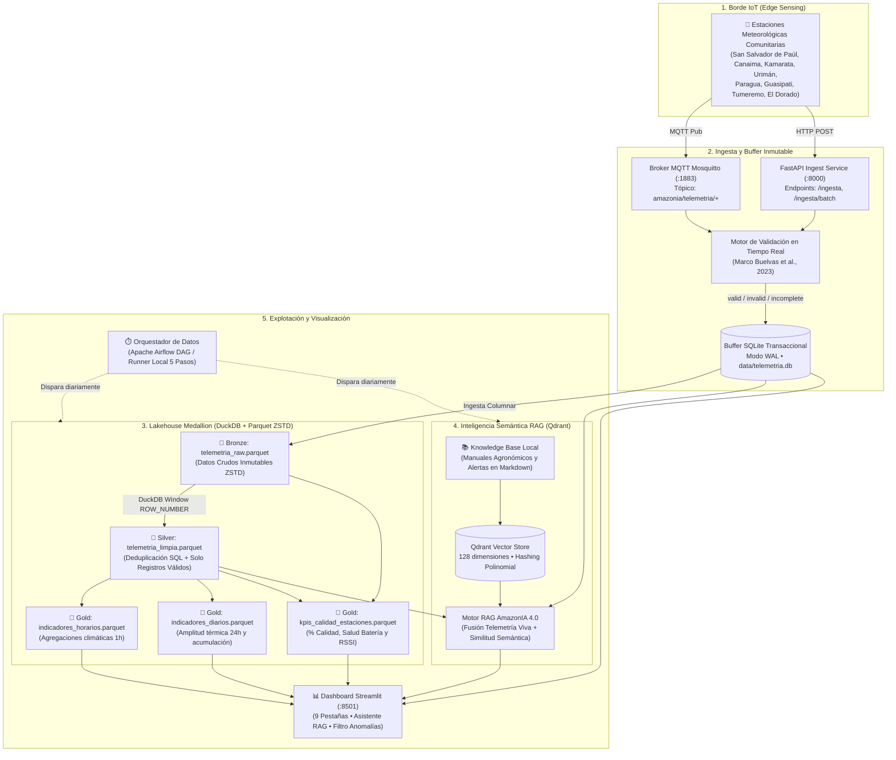
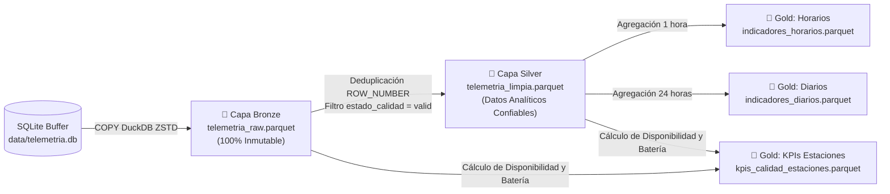
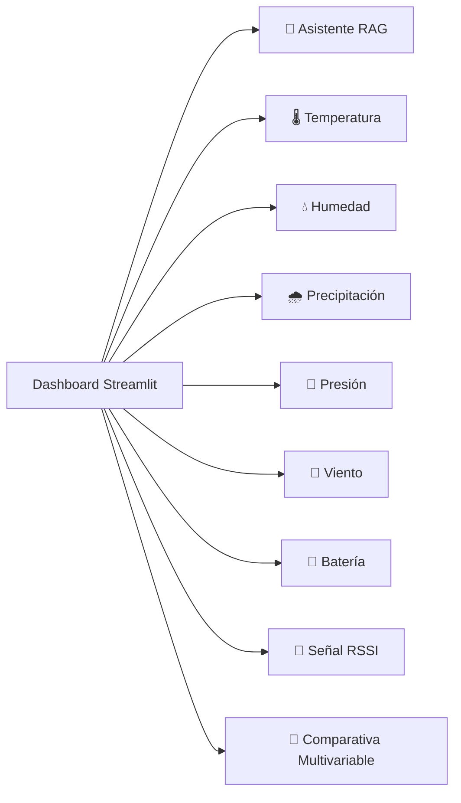

# 🌿 AmazonIA 4.0 — Guía Integral de Presentación y Defensa Técnica
## Telemetría Microclimática, Lakehouse Medallion y Memoria Semántica en la Cuenca del Río Caroní

---

## 📌 Ficha Técnica del Proyecto

* **Institución:** Universidad Nacional Experimental de Guayana (UNEG)
* **Programa:** Maestría en Tecnologías de la Información
* **Asignatura:** Tipos de Datos Inteligentes
* **Docente Titular:** Profa. Livia Borjas
* **Equipo de Desarrollo e Investigación:**
  * Massiel Barrios — C.I. V-27.375.910
  * Luis Pizzanni — C.I. V-27.765.210
  * Junior Rodríguez — C.I. V-23.730.853
* **Ubicación Geográfica del Caso de Estudio:** Cuenca del Río Caroní (Estado Bolívar, Venezuela)
* **Repositorio y Código Fuente:** `amazonia4.0-mvp`
* **Tipo de Documento:** Guión y manual maestro secuencial para la presentación oral y demostración en vivo del sistema ante el jurado calificador y la audiencia técnica.

---

## ⏱️ Estructura Secuencial de la Presentación (Cronograma Sugerido)

| Sección | Tema Principal | Tiempo Sugerido | Responsable / Enfoque |
| :--- | :--- | :--- | :--- |
| **Bloque 1** | Contexto, Justificación y Problema en el Caroní | 3 - 4 min | Fundamentación ambiental, social y científica |
| **Bloque 2** | Arquitectura Global y Paradigma Offline-First | 3 - 4 min | Modelo conceptual, capas de datos y resiliencia |
| **Bloque 3** | Ingesta, Validación de Calidad y Edge Storage | 4 - 5 min | Protocolos MQTT/REST, SQLite WAL, Buelvas et al. |
| **Bloque 4** | Lakehouse Medallion con DuckDB y Parquet | 5 - 6 min | Transición Bronze → Silver → Gold y Datamarts |
| **Bloque 5** | Memoria Semántica y Asistente RAG con Qdrant | 4 - 5 min | Embeddings locales 128d, base agronómica, fusión |
| **Bloque 6** | Demostración en Vivo: Dashboard Streamlit | 5 - 6 min | Navegación, gráficas, filtro de anomalías, chat RAG |
| **Bloque 7** | Orquestación (Airflow / Runner Local) y Pruebas | 2 - 3 min | Automatización de tareas, 55 pruebas Pytest |
| **Bloque 8** | Conclusiones, Impacto Regional y Ronda de Preguntas | 5 min | Respuestas al jurado técnico |

---

## 🌊 BLOQUE 1: Contexto, Justificación y Problemática Real

### 1.1. La Cuenca del Río Caroní: Importancia Estratégica
La cuenca del río Caroní abarca más de 95.000 km² en el sur de Venezuela. Es el corazón energético de la nación, ya que alimenta el complejo hidroeléctrico del Bajo Caroní (Guri/Simón Bolívar, Macagua, Caruachi y Tocoma), responsable de suministrar más del 70% de la energía eléctrica del país. Asimismo, alberga comunidades indígenas (Pemón, Yekuana) y asentamientos agrícolas rurales que dependen de la agricultura familiar (yuca, plátano, maíz, cacao).

### 1.2. El Problema Técnico y Ambiental en Campo
Las soluciones tradicionales de monitoreo ambiental basadas en la nube comercial (AWS IoT, Azure IoT Central, Google Cloud IoT) fracasan rotundamente en la Amazonía venezolana debido a tres factores críticos:
1. **Aislamiento de Conectividad:** La cobertura de telefonía móvil celular es prácticamente inexistente o muy inestable fuera de los centros urbanos. Los enlaces satelitales son costosos, intermitentes y de escaso ancho de banda.
2. **Inestabilidad Energética Severa:** Frecuentes caídas de tensión y apagones prolongados impiden el funcionamiento continuo de servidores convencionales. Los nodos de monitoreo dependen de pequeños paneles solares y baterías que sufren degradación.
3. **Pérdida Crítica de Telemetría:** Un corte de red en una arquitectura centralizada provoca la desconexión del sensor y la pérdida definitiva de lecturas climáticas clave (picos de crecida o sequías extremas).
4. **Desconexión entre el Dato y la Comunidad:** Los datos de telemetría crudos (ej. "humedad 94%, presión 950 hPa") carecen de utilidad directa para los agricultores si no se traducen en lenguaje natural con recomendaciones prácticas sobre siembra, plagas y alertas tempranas de crecidas fluviales.

### 1.3. Soporte en Literatura Científica Indexada
El proyecto se fundamenta directamente en literatura indexada en Scopus y SciELO sobre calidad de datos y resiliencia en IoT:
* **Buelvas et al. (2023):** Metodología estandarizada para evaluar y clasificar la calidad de datos IoT en tres estados determinísticos: `valid` (válido), `invalid` (fuera de rango físico o termodinámico) e `incomplete` (trama con campos nulos).
* **Bezerra et al. (2020) & Alarcón et al. (2021):** Investigaciones sobre arquitecturas de borde (*Edge Computing*) y almacenamiento transaccional local en cuencas hidrográficas neotropicales sin conectividad.

---

## 🏛️ BLOQUE 2: Arquitectura del Sistema de Datos Inteligente

### 2.1. Visión General y Paradigma Offline-First
AmazonIA 4.0 opera bajo el principio de **Continuidad Operativa Local Total (Offline-First)**: el sistema procesa, almacena, depura, analiza y genera diagnósticos de inteligencia artificial directamente en el borde geográfico, sin requerir internet ni conexión con servidores externos.

### 2.2. Diagrama de Arquitectura de Extremo a Extremo



---

## 📡 BLOQUE 3: Ingesta, Conectividad y Validación en el Borde

### 3.1. Nodos de Telemetría Microclimática
El sistema monitoriza 8 variables ambientales y operativas por cada estación:
1. **Temperatura del Aire (°C):** Monitoreo del estrés térmico en plantas.
2. **Humedad Relativa (%):** Detección de ambientes propicios para hongos patógenos.
3. **Presión Atmosférica (hPa):** Detección de frentes de baja presión y tormentas tropicales.
4. **Precipitación Pluvial (mm):** Monitoreo de crecidas del río Caroní e inundaciones.
5. **Velocidad del Viento (km/h):** Riesgo de acame en plantaciones de plátano y maíz.
6. **Voltaje de Batería (V):** Estado de salud del sistema fotovoltaico (límite crítico < 3.2V).
7. **Nivel de Señal RSSI (dBm):** Calidad de la señal de radiofrecuencia (LoRa/WiFi).
8. **Estampa de Tiempo (Timestamp ISO 8601):** Trazabilidad temporal estricta.

### 3.2. Canales de Ingesta Dual (MQTT + REST API)
* **Broker MQTT Mosquitto (`tcp://localhost:1883`):** Protocolo ultraligero de mensajería binaria/JSON para microcontroladores ESP32 y radios LoRaWAN mediante el tópico `amazonia/telemetria/{estacion_id}`.
* **API REST con FastAPI (`http://localhost:8000`):**
  * `POST /ingesta`: Recepción atómica individual de tramas de telemetría.
  * `POST /ingesta/batch`: Ingesta masiva por lotes (para sincronización tras reconexiones).
  * `GET /telemetria/recientes`: Lectura de últimas muestras para gateways y tableros.
  * `GET /alertas`: Detección en vivo de rebasamiento de umbrales.
  * `GET /health`: Monitoreo del estado de salud del gateway.

### 3.3. Motor de Validación de Calidad de Datos (Buelvas et al., 2023)
Cada trama que llega al sistema pasa obligatoriamente por una inspección termodinámica y lógica antes de persistirse:
* **Estado `valid`:** Todos los valores se encuentran dentro de rangos plausibles en la naturaleza (-10 °C a 45 °C, humedad de 0 a 100%, presión de 800 a 1100 hPa, precipitación de 0 a 300 mm, viento de 0 a 150 km/h, batería de 2.5 a 5.0 V, RSSI de -120 a 0 dBm).
* **Estado `invalid`:** Uno o más sensores emitieron un valor físicamente imposible (ej. temperatura de 150 °C por falla del termistor, o batería en 0.5 V). La trama **no se descarta**: se preserva en el buffer para auditoría con una descripción explícita en el campo `errores` (ej. `Temperatura fuera de rango: 150.0°C`).
* **Estado `incomplete`:** La trama omitió campos obligatorios o contiene valores nulos.

### 3.4. Buffer Transaccional SQLite en Modo WAL
* Implementado en `data/telemetria.db`.
* Configurado con **WAL (Write-Ahead Logging)** y `synchronous = NORMAL`.
* **Beneficio técnico:** Permite lecturas analíticas concurrentes de alta velocidad mientras los hilos de ingesta siguen escribiendo datos sin bloqueos de tabla.
* Cuenta con la bandera booleana `sincronizado` (0 = pendiente en el borde, 1 = replicado en el servidor central).

---

## 🏗️ BLOQUE 4: Lakehouse Medallion con DuckDB y Parquet

### 4.1. Por qué DuckDB en lugar de Spark/Hadoop
En un entorno aislado en la selva o sabana, una infraestructura pesada como Hadoop o Apache Spark consumiría gigabytes de memoria RAM y requeriría Java Virtual Machine (JVM).
**DuckDB** ofrece:
* Motor OLAP embebido en C++ que opera dentro del mismo proceso Python.
* Procesamiento vectorial columnar con SIMD.
* Ejecución de consultas SQL de alto rendimiento directamente sobre archivos Parquet comprimidos en disco sin necesidad de cargarlos previamente en memoria.

### 4.2. Las Tres Capas de la Arquitectura Medallion



#### 🥉 Capa Bronze (`telemetria_raw.parquet`)
* **Propósito:** Almacén crudo inmutable (fiel reflejo de lo transmitido por los sensores).
* **Tecnología:** Apache Parquet con compresión de alto nivel **ZSTD**.
* **Resultado:** Reducción de tamaño del 75% al 85% respecto al almacenamiento relacional sin pérdida de precisión.

#### 🥈 Capa Silver (`telemetria_limpia.parquet`)
* **Propósito:** Registro analítico depurado, estandarizado y de alta fidelidad.
* **Transformaciones SQL ejecutadas por DuckDB:**
  1. **Deduplicación:** Elimina retransmisiones duplicadas provocadas por reintentos de red LoRa mediante:
     ```sql
     ROW_NUMBER() OVER (PARTITION BY estacion_id, timestamp ORDER BY id DESC) = 1
     ```
  2. **Filtrado de Calidad Estricto:** Excluye registros marcados como `invalid` o `incomplete`.
  3. **Normalización:** Homogeneiza estampas temporales y tipos numéricos.

#### 🥇 Capa Gold (Datamarts Especializados)
Diseñados para consultas analíticas instantáneas de tableros directivos y modelos predictivos:
1. **`indicadores_horarios.parquet`:** Calcula por cada estación y hora el promedio, mínimo y máximo de temperatura, humedad relativa, acumulación de lluvia y ráfagas de viento.
2. **`indicadores_diarios.parquet`:** Resumen bioclimático diario (24 horas). Calcula la **amplitud térmica** ($\Delta T = T_{max} - T_{min}$), indicador clave para la floración y fructificación de cultivos, y el volumen diario de lluvia acumulada.
3. **`kpis_calidad_estaciones.parquet`:** Mide el rendimiento operativo de cada estación en campo:
   * Porcentaje de calidad (% de lecturas válidas vs totales).
   * Voltaje medio y mínimo de batería para predecir fallas energéticas.
   * Promedio de RSSI para detectar desalineación de antenas o interferencias por crecimiento de vegetación.

---

## 🧠 BLOQUE 5: Memoria Semántica y Asistente RAG con Qdrant

### 5.1. El Concepto de RAG (Retrieval-Augmented Generation) en el Borde
El asistente inteligente no depende de un modelo generativo remoto en la nube ni de tokens de pago. Integra una **memoria semántica vectorial local** que busca en manuales técnicos agronómicos e hidrológicos y los cruza en milisegundos con los datos vivos de las estaciones meteorológicas.

### 5.2. Base de Conocimiento Especializada (`knowledge_base/`)
Contiene tres documentos normativos estructurados en Markdown:
1. **`guia_agroclimatica_caroni.md`:** Parámetros bioclimáticos óptimos, rangos críticos de humedad, temperatura y requerimientos de drenaje para cultivos de la cuenca: Yuca Amarga/Dulce (*Manihot esculenta*), Maíz Cariaco (*Zea mays*), Plátano Hartón (*Musa paradisiaca*) y Cacao Criollo (*Theobroma cacao*).
2. **`protocolo_alertas_comunitarias.md`:** Protocolos de acción comunitaria ante crecidas del río Caroní, umbrales de lluvia acumulada (>50 mm/h o >100 mm/24h), vientos destructivos y directrices de resguardo de enseres y animales.
3. **`manual_mantenimiento_estaciones.md`:** Protocolos de soporte técnico en campo: limpieza de celdas solares con sarro, calibración de pluviómetros de balancín y sustitución de baterías de litio LiFePO4.

### 5.3. Motor Vectorial Qdrant y Embeddings Determinísticos (128d)
* **Qdrant Vector Store:** Motor de base de datos vectorial de alto rendimiento configurado para operar en dos modalidades:
  1. Conexión HTTP al servidor Qdrant (`http://localhost:6333`).
  2. **Fallback Offline-First Automático:** Si el servicio en contenedor no está presente, Qdrant activa su motor local en disco (`data/qdrant_storage/`), garantizando indexación y búsqueda sin dependencias de red.
* **Embeddings Locales de 128 Dimensiones:**
  * Desarrollados a la medida para entornos sin GPU.
  * Emplean hash polinomial ponderado de n-gramas y bigramas léxicos con normalización euclídea $L_2$:
    $$\vec{v}_{norm} = \frac{\vec{v}}{\|\vec{v}\|_2}$$
  * Generan representaciones densas y determinísticas sin requerir modelos masivos de HuggingFace/PyTorch de cientos de megabytes.

### 5.4. Fusión Semántica en Tiempo Real (`src/rag/engine.py`)
Cuando un usuario hace una pregunta (ej. *"¿Es seguro sembrar yuca hoy?"*):
1. El motor extrae las métricas reales de las últimas 24 horas de la estación seleccionada (Temperatura actual, Humedad, Precipitación acumulada, Viento).
2. Vectoriza la pregunta del usuario y recupera mediante similitud del coseno los fragmentos normativos más relevantes de Qdrant.
3. El motor de razonamiento combina las directrices técnicas con la telemetría viva y emite un veredicto contextualizado:
   > *"Condiciones actuales en San Salvador de Paúl: Temperatura 27.8°C, Humedad 88.5%, Lluvia acumulada 68.2 mm. Evaluación: No es recomendable sembrar yuca amarga hoy. El suelo presenta saturación hídrica severa que induce asfixia radicular. Se recomienda esperar 48 horas sin lluvias y verificar drenaje."*

---

## 📊 BLOQUE 6: Demostración en Vivo: Dashboard Streamlit

### 6.1. Organización Visual y Controles en la Barra Lateral
Al acceder a `http://localhost:8501`, el usuario dispone de:
* **Selector de Estación:** Permite evaluar estaciones específicas (ej. `EST_CARONI_001` - San Salvador de Paúl, `EST_CARONI_002` - Parque Nacional Canaima) o seleccionar `"Todas"` para análisis comparativo inter-estaciones.
* **Ventana Temporal:** Filtros rápidos predefinidos (Última hora, 24 horas, 7 días, 30 días, 1 año o Todo el historial).
* **Slider de Registros:** Control de volumen de consulta (50 a 5.000 registros).
* **Switch de "Filtrar anomalías en gráficas" (Activado por defecto):**
  * **Innovación en la visualización:** Excluye las lecturas con estado `invalid` de las curvas de tendencia y cálculos estadísticos (Mínimo, Máximo, Media, Desviación Estándar).
  * **Beneficio:** Evita que una lectura errónea de un sensor descalibrado (ej. 150 °C) deforme la escala del gráfico y arruine el análisis de la tendencia real.

### 6.2. Las 9 Pestañas de Análisis Técnico



1. **🌱 Asistente Agroclimático RAG:** Chat interactivo que incluye 4 botones de consulta rápida:
   * *¿Es seguro sembrar yuca o maíz hoy?*
   * *¿Cuál es el nivel de riesgo de inundación?*
   * *¿Cuál es el estado de las baterías?*
   * *¿El viento amenaza los platanales?*
   * Incluye un acordeón desplegable que muestra la evidencia vectorial exacta recuperada de Qdrant y la telemetría viva utilizada.
2. **🌡️ Temperatura:** Curva cronológica continua con cálculo de estadísticos (Mín, Media, Máx, Desv. Estándar) y línea roja de umbral de calor extremo a los 40 °C.
3. **💧 Humedad Relativa:** Gráfica de evolución higrométrica con cálculo de medias y extremos.
4. **🌧️ Precipitación:** Gráfico de barras de lluvia acumulada con línea de umbral de lluvia intensa a los 50 mm y conteo de eventos de lluvia.
5. **🧭 Presión Atmosférica:** Tendencia barométrica para detección de borrascas y tormentas.
6. **💨 Velocidad del Viento:** Gráfico de área con identificación de rachas máximas y línea de alerta de vendaval a los 80 km/h.
7. **🔋 Estado de Energía y Batería:** Gráfica de descarga de la batería solar con línea roja de nivel crítico a los 3.2 V.
8. **📶 Calidad de Enlace (RSSI):** Indicador de estabilidad de la señal inalámbrica (en dBm).
9. **🔄 Comparativa Multivariable:** Gráfico de dispersión interactivo (*Scatter Plot*) correlacionando Temperatura vs Humedad, donde el tamaño del punto representa la Precipitación y el color identifica a la estación.

### 6.3. Sección de Diagnóstico de Calidad y Alertas en Ventana
* **Gráfico Circular de Distribución de Calidad:** Muestra el desglose porcentual de tramas `valid` (verde), `invalid` (rojo) e `incomplete` (naranja).
* **Detector Continuo de Alertas en Ventana:** Escanea todos los registros de la ventana activa para notificar en tiempo real:
  * ❌ *Falla de Calidad / Sensor Inválido:* Alerta inmediata cuando un sensor falla, indicando la estación y el parámetro fuera de norma.
  * ⚠️ *Telemetría Incompleta:* Detección de tramas truncadas.
  * 🌧️ *Lluvia Intensa (> 50 mm):* Riesgo de desbordamiento de ríos o quebradas.
  * 🔥 *Calor Extremo (> 40 °C):* Riesgo de choque térmico en cultivos.
  * 🔋 *Batería Baja (< 3.2 V):* Advertencia de apagón inminente del nodo.
  * 💨 *Viento Fuerte (> 80 km/h):* Alerta de desprendimiento de techos y acame agrícola.

### 6.4. Tabla de Registros Recientes con Resaltado Inteligente en Rojo
* Diseñada para el personal de campo y mantenimiento.
* **Estilo condicional automatizado:** Si una fila contiene valores anómalos (`invalid`), el sistema ilumina en **fondo rojo suave y texto rojo oscuro en negrita** la celda específica de la variable responsable (ej. una celda de temperatura con `150.0` o una batería en `1.8`), además de detallar la causa en la columna `errores`.

---

## ⚙️ BLOQUE 7: Orquestación, Sincronización y Modos de Ejecución

### 7.1. Mecanismo de Sincronización Edge → Servidor Central (`src/sincronizacion.py`)
* Diseñado para operar en conectividad intermitente (*Store and Forward*):
  1. Durante periodos sin red, las lecturas se guardan en SQLite con `sincronizado = 0`.
  2. Un servicio de fondo supervisa la disponibilidad de enlace mediante un **health check no bloqueante** con timeout de 1 segundo.
  3. Cuando se detecta red, los datos se transmiten en lotes acotados (`max_lotes = 10` para prevenir saturación de ancho de banda).
  4. Solo tras recibir confirmación HTTP 200/201 del servidor central, las tramas locales se marcan de forma atómica como `sincronizado = 1`.

### 7.2. Pipeline Analítico Medallion: Orquestación Unificada
El procesamiento analítico puede orquestarse mediante dos modalidades idénticas en lógica:

#### A. Runner Local Secuencial (`python run_pipeline_local.py`)
Ejecuta las 5 etapas analíticas de manera transparente en consola:
1. **[1/5] Sincronización Edge Buffer:** Transmisión de lotes pendientes con salvaguarda de reintentos.
2. **[2/5] Capa Bronze → Silver (DuckDB):** Ingesta columnar desde SQLite hacia Parquet Raw y depuración estricta SQL hacia Parquet Silver.
3. **[3/5] Capa Gold (Datamarts):** Generación de los archivos Parquet de agregaciones horarias, diarias y KPIs de calidad.
4. **[4/5] Indexación Semántica RAG:** Lectura de guías Markdown, chunking semántico e indexación vectorial en Qdrant.
5. **[5/5] Evaluación de Umbrales de Alerta:** Verificación de variables climáticas críticas.

#### B. Apache Airflow (`dags/pipeline_amazonia.py`)
* DAG programado diariamente (`@daily`) o cada hora.
* Grafica de dependencias estricta:
  ```
  sincronizar_edge >> bronze_to_silver >> silver_to_gold >> rag_indexer >> verificar_alertas
  ```
* Proporciona trazabilidad empresarial, registro de logs por tarea y reintentos automatizados.

### 7.3. Validación de Calidad del Software (55+ Pruebas Automatizadas)
El sistema cuenta con una cobertura integral de pruebas unitarias y de integración ejecutadas mediante `pytest`:
* `tests/test_lakehouse.py`: Validación de esquemas Parquet, deduplicación SQL y consistencia de datamarts Gold (10 pruebas).
* `tests/test_pipeline.py`: Pruebas de integración del pipeline completo y validaciones termodinámicas (7 pruebas).
* `tests/test_rag.py`: Pruebas del almacén vectorial Qdrant, embeddings determinísticos y motor de inferencia (6 pruebas).
* `tests/test_api.py` y `tests/test_validaciones.py`: Cobertura de endpoints REST, broker MQTT y reglas de Buelvas et al. (32 pruebas).
* **Resultado:** 100% de pruebas superadas exitosamente (`55 passed`).

---

## 🚀 BLOQUE 8: Guía de Demostración Práctica para el Día de la Defensa

Para realizar una presentación fluida ante el jurado, se recomienda seguir este orden de comandos en vivo:

### Paso 1: Iniciar el Ecosistema Completo
Abrir una terminal de comandos en la raíz del proyecto y ejecutar:
```bash
python start.py
```
* **Qué explicar al jurado:** Indicar que este script inicializa de forma concurrente el API Gateway FastAPI en el puerto 8000, el Dashboard interactivo Streamlit en el puerto 8501 y el Simulador de Nodos de la cuenca del Caroní generando telemetría sintética con variabilidad climática real y eventos anómalos controlados.

### Paso 2: Mostrar el Dashboard Operativo
Abrir el navegador web en `http://localhost:8501`:
1. **Demostrar el Asistente RAG:** Hacer clic en el botón *"¿Es seguro sembrar yuca o maíz hoy?"*. Mostrar la respuesta contextualizada y desplegar el acordeón para evidenciar cómo recuperó los fragmentos técnicos de la guía agroclimática desde Qdrant.
2. **Demostrar las Curvas Microclimáticas:** Navegar por las pestañas de Temperatura, Humedad y Precipitación. Mostrar las líneas de umbral de alerta.
3. **Demostrar el Filtro de Anomalías:** Desactivar momentáneamente la casilla *"Filtrar anomalías en gráficas"* en la barra lateral para que el jurado observe cómo los datos erróneos desvirtúan la escala; luego volver a activarla para evidenciar la depuración de datos inteligente.
4. **Demostrar la Tabla con Resaltado Rojo:** Ir a la sección inferior de la pantalla y mostrar las celdas en color rojo destacando fallas de sensores en tiempo real.

### Paso 3: Ejecutar el Pipeline Medallion & RAG en Consola
En una segunda terminal, ejecutar:
```bash
python run_pipeline_local.py
```
* **Qué explicar al jurado:** Explicar cómo DuckDB procesa en milisegundos miles de registros desde SQLite hacia Parquet ZSTD (Bronze), depura duplicados y anomalías (Silver), calcula los agregados analíticos (Gold) y actualiza la memoria vectorial RAG sin recurrir a la nube.

### Paso 4: Evidenciar el Almacenamiento Lakehouse Parquet
Mostrar en el explorador de archivos o consola el directorio `data/lakehouse/`:
* `bronze/telemetria_raw.parquet`
* `silver/telemetria_limpia.parquet`
* `gold/indicadores_horarios.parquet`
* `gold/indicadores_diarios.parquet`
* `gold/kpis_calidad_estaciones.parquet`
* Enfatizar el peso reducido de los archivos (pocos kilobytes) gracias a la compresión columnar ZSTD.

---

## ❓ BLOQUE 9: Preguntas Frecuentes del Jurado Calificador y Respuestas Clave

### P1: ¿Por qué no utilizaron una base de datos relacional tradicional (PostgreSQL o MySQL) para todo el sistema?
> **Respuesta:** En el borde geográfico, PostgreSQL requeriría la instalación y administración de un servicio de base de datos pesado con alto consumo de memoria RAM y riesgo de corrupción de índices ante apagones repentinos. SQLite en modo WAL ofrece un buffer transaccional de cero configuración y altísima resiliencia eléctrica. Adicionalmente, para analítica agregada (calcular promedios de millones de datos), las bases relacionales basadas en filas son ineficientes; el Lakehouse columnar con DuckDB y Parquet permite lecturas hasta 50 veces más rápidas con una fracción del espacio en disco.

### P2: Si la zona no tiene conexión a internet, ¿cómo funciona el RAG sin la API de OpenAI o Gemini?
> **Respuesta:** Implementamos una arquitectura RAG *Offline-First*. En lugar de invocar APIs comerciales que requieren enlace satelital o fibra óptica, AmazonIA 4.0 utiliza un generador determinístico de embeddings semánticos de 128 dimensiones y la base de datos vectorial Qdrant en almacenamiento local en disco. La correlación entre la telemetría viva y los manuales agroclimáticos se efectúa enteramente en la CPU del gateway local.

### P3: ¿Por qué no descartaron las lecturas con estado `invalid` en el momento de la ingesta?
> **Respuesta:** Siguiendo los principios de ingeniería de datos y el marco metodológico de Buelvas et al. (2023), descartar datos en la puerta de entrada destruye la auditabilidad del sistema. Al registrar la trama cruda en SQLite y en la Capa Bronze como `invalid`, se preserva la evidencia forense para que el equipo de campo diagnostique si un sensor de temperatura se descalibró, si un cable se sulfató o si la batería cayó por debajo de su voltaje operativo. La exclusión se realiza de forma limpia en la Capa Silver y en las curvas analíticas del Dashboard.

### P4: ¿Qué ventajas aporta este sistema para las comunidades indígenas y agrícolas del Caroní?
> **Respuesta:** Transforma la telemetría abstracta en alertas operativas comprensibles. Una comunidad no necesita interpretar voltajes o presiones en milibares; el sistema les indica en lenguaje natural cuándo evacuar zonas bajas por crecidas del río Caroní, cuándo proteger cultivos de plátano por ráfagas de viento y qué días son propicios para sembrar yuca o maíz sin riesgo de pérdida de cosecha.

---

## 🏁 BLOQUE 10: Conclusión del Equipo de Investigación

**AmazonIA 4.0** demuestra que es posible diseñar e implementar sistemas de datos inteligentes de vanguardia en regiones de alta hostilidad ambiental y desconexión tecnológica. 

Al articular armónicamente la captura IoT, la validación formal de calidad de datos, el almacenamiento columnar Lakehouse Medallion con DuckDB y la memoria semántica RAG, el proyecto entrega una solución de ingeniería robusta, reproducible y de alto impacto socio-productivo para la soberanía tecnológica de la cuenca del Río Caroní y la Universidad Nacional Experimental de Guayana.
